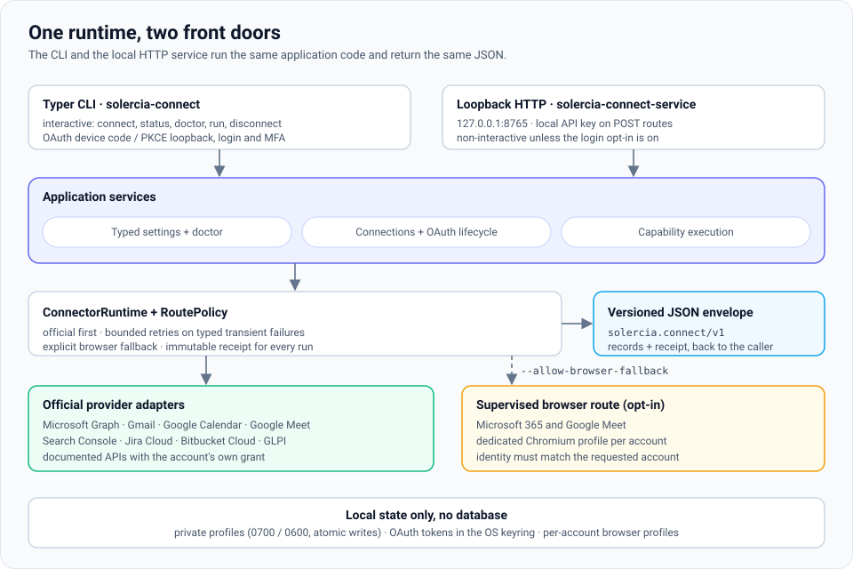
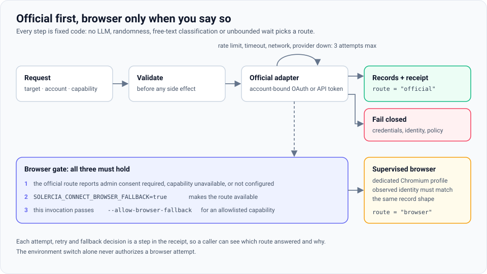
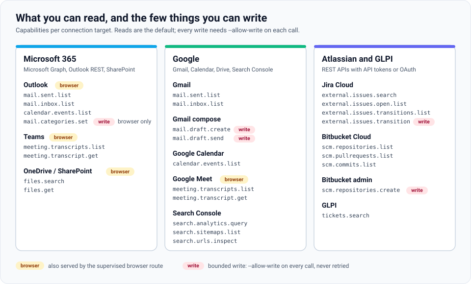
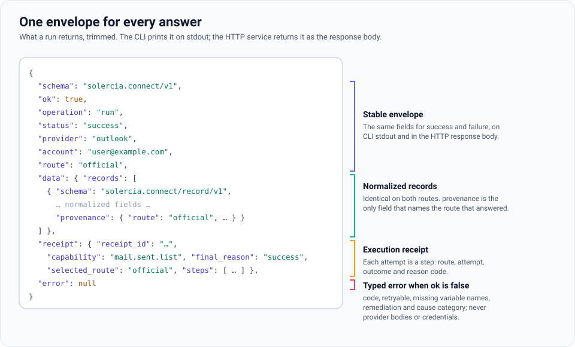
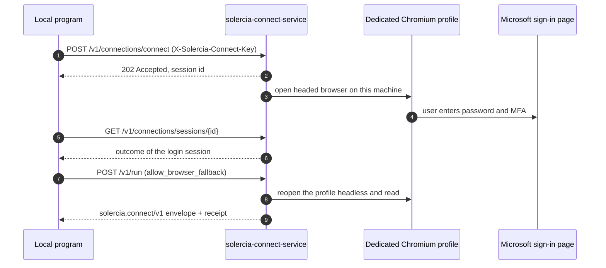

<div align="center">

# Solercia Connect

**Deterministic, official-first connectors for mail, calendars, meetings, files, issues and repositories.**

One local runtime reads Microsoft 365, Google, Jira, Bitbucket and GLPI through their official APIs, falls back to a supervised browser only when you explicitly allow it, and answers every call with the same versioned JSON and an audit receipt.

[](LICENSE)
[](pyproject.toml)
[](pyproject.toml)
[](pyproject.toml)
[-2ead33?logo=playwright&logoColor=white)](pyproject.toml)
[](docs/ARCHITECTURE.md)

</div>

---

Solercia Connect is a standalone Python 3.12 connector runtime. It owns provider configuration, the OAuth connection lifecycle, official-first reads, normalized records and versioned machine-readable receipts. It does not require a database or another Solercia product.

Offline tests prove the local contracts. They do **not** prove real tenant consent, provider availability or external browser stability; those remain explicit live-validation gates.

## Contents

- [How it works](#how-it-works)
- [Quick start](#quick-start)
- [Capabilities](#capabilities)
- [Bounded writes](#bounded-writes)
- [Meeting transcripts](#meeting-transcripts)
- [Files on OneDrive and SharePoint](#files-on-onedrive-and-sharepoint)
- [Bitbucket Cloud](#bitbucket-cloud)
- [Loopback HTTP service](#loopback-http-service)
- [Provider readiness](#provider-readiness)
- [Configuration](#configuration)
- [Development and verification](#development-and-verification)
- [Documentation](#documentation)
- [License](#license)

## How it works

### One runtime, two front doors

<p align="center">
  
</p>

- The **Typer CLI** (`solercia-connect`) is the canonical interactive interface: it connects accounts, runs device-code or PKCE OAuth, and hosts login and MFA when a browser route is needed.
- The **loopback HTTP service** (`solercia-connect-service`, `127.0.0.1:8765`) is a non-interactive adapter over the same application services. Extraction routes require a local API key.
- The **runtime** applies a fixed route policy and returns the same envelope to both. Local state lives in private files and the OS keyring; there is no database.

### Official first, browser only when you say so

<p align="center">
  
</p>

1. Validate target and account before side effects.
2. Use the configured official adapter and one account-bound OAuth token set.
3. Retry only typed transient failures within fixed bounds.
4. Fail closed for credentials, identity mismatch, provider policy, malformed data and unknowns.
5. Consider the browser fallback only after the invocation supplies `--allow-browser-fallback` and an allowlisted capability and reason. The global environment switch can make the route available but cannot grant per-invocation authority. A connected browser session is not an extraction claim.

No LLM, randomness, free-text classification or unbounded wait selects a route.

### What you can read and write

<p align="center">
  
</p>

### One envelope for every answer

<p align="center">
  
</p>

CLI and HTTP responses use `solercia.connect/v1` with stable fields: `ok`, `operation`, `status`, `provider`, `account`, `route`, `data`, `receipt` and `error`. Normalized records carry `solercia.connect/record/v1`. Records are identical across routes; `provenance` is the only field that names the route. Errors include a safe code, retryability, missing variable **names**, remediation and a cause category, never provider bodies or credentials.

Relevant CLI commands accept `--output PATH`; writes are atomic, mode `0600`, reject symlinks and do not overwrite unless `--force` is explicit. Stdout remains JSON for machine consumption.

## Quick start

```bash
make setup
make doctor TYPE=outlook ACCOUNT=user@example.com
make connect TYPE=outlook ACCOUNT=user@example.com
make test
```

The installed Typer CLI is the canonical interactive interface:

```bash
solercia-connect connect outlook user@example.com
solercia-connect status outlook user@example.com
solercia-connect disconnect outlook user@example.com
```

The root wrapper is only a convenience alias and contains no provider logic:

```bash
./solercia-connect.sh outlook user@example.com
./solercia-connect.sh outlook user@example.com --allow-browser-fallback
```

### Microsoft without an app registration (browser route)

For a Microsoft browser-only setup, the `service`, `doctor` and `connect` Make targets explicitly select the repository's `.env.local` when that file exists. With `SOLERCIA_CONNECT_BROWSER_FALLBACK=true` in that file and no Microsoft client ID, authorize this invocation explicitly:

```bash
make setup-browser
make connect TYPE=outlook ACCOUNT=user@example.com ALLOW_BROWSER_FALLBACK=1
```

The official OAuth route is skipped because it is unavailable. After the user completes login and MFA in the dedicated Solercia profile, the visible Chromium window intentionally closes. It is used only for login and MFA; cookies and local storage persist in the private account-scoped profile on disk, not in an always-running browser daemon. Connect immediately reopens that same profile headless and requires the same unique observed account before the successful envelope reports `connected_browser`.

Outlook proves that identity with the web session's own read-only `GET https://outlook.office.com/api/v2.0/me` response and canonical `EmailAddress`; it does not depend on Outlook DOM identity selectors. The captured browser authorization is transient, accepted only from HTTPS Outlook/Substrate host allowlists, and is never logged or persisted. Teams keeps its separate versioned DOM current-account proof. After the headless check, Chromium closes and the synchronous command returns to the console; no daemon or background worker remains:

```json
{"status": "connected_browser", "route": "browser",
 "data": {"extraction_status": "available",
          "capabilities": ["mail.sent.list", "mail.inbox.list"]}}
```

Once connected, sent mail is read over the same supervised session through the documented read-only Outlook REST collection, with the same strict range and paging as the official route. The envelope declares what that route can extract, so a caller never has to guess:

```bash
SOLERCIA_CONNECT_ENV_FILE=.env.local \
  solercia-connect run outlook mail.sent.list user@example.com \
  --start 2026-08-01 --end 2026-09-01 --allow-browser-fallback --output sent.json
```

Make never prints the environment file values. Direct CLI use still requires explicitly exporting `SOLERCIA_CONNECT_ENV_FILE=.env.local`; configuration availability alone never authorizes a browser attempt. Later status checks also reopen the same profile headless and close it when verification finishes:

```bash
make connect TYPE=outlook ACCOUNT=user@example.com ALLOW_BROWSER_FALLBACK=1
SOLERCIA_CONNECT_ENV_FILE=.env.local \
  solercia-connect status outlook user@example.com --allow-browser-fallback
```

Official status checks need no browser flag. If the stored route is browser-backed, status and the compatibility commands require a fresh explicit authorization:

```bash
solercia-connect status outlook user@example.com --allow-browser-fallback
solercia-connect m365 status --allow-browser-fallback
```

### Run a capability

Use timezone-aware, exact, end-exclusive ranges:

```bash
solercia-connect run \
  --provider google.calendar \
  --capability calendar.events.list \
  --start '2026-08-01T00:00:00-05:00' \
  --end '2026-09-01T00:00:00-05:00' \
  --account user@example.com
```

## Capabilities

| Capability | Official | Browser (supervised session) |
|---|---|---|
| `mail.sent.list` (with attachments) | yes | yes |
| `mail.inbox.list` (Outlook) | yes | yes |
| `mail.inbox.list` (Gmail) | yes — Gmail API, `in:inbox` | no (official-only) |
| `calendar.events.list` | yes | yes |
| `files.search` / `files.get` | yes | yes |
| `meeting.transcripts.*` (Microsoft) | yes | yes — different selector, see [Meeting transcripts](#meeting-transcripts) |
| `meeting.transcripts.*` (`google-meet`) | yes — Calendar + Drive APIs | yes — Calendar web + Docs `mobilebasic`, window only |
| `mail.categories.set` (write) | no — needs `Mail.ReadWrite` | yes, with `--allow-write` |
| `external.issues.open.list` (Jira) | yes — REST v3, enhanced JQL | no (official-only) |
| `external.issues.transitions.list` (Jira) | yes — REST v3 | no (official-only) |
| `external.issues.transition` (Jira write) | yes, with `--allow-write`; API token only | no (official-only) |
| `mail.draft.create` (Gmail write, `gmail-compose`) | yes, with `--allow-write` | no (official-only) |
| `mail.draft.send` (Gmail write, `gmail-compose`) | yes, with `--allow-write` | no (official-only) |
| `scm.repositories.list` (Bitbucket) | yes — REST 2.0 | no (official-only) |
| `scm.pullrequests.list` (Bitbucket) | yes — REST 2.0 | no (official-only) |
| `scm.commits.list` (Bitbucket) | yes — REST 2.0 | no (official-only) |
| `scm.repositories.create` (Bitbucket write, `bitbucket-admin`) | yes, with `--allow-write` | no (official-only) |

Search Console (`search.analytics.query`, `search.sitemaps.list`, `search.urls.inspect`) and GLPI (`tickets.search`) are official-only; see the [runbooks](docs/runbooks/).

Outlook mail records from `mail.inbox.list` and `mail.sent.list` also carry `categories`: the Outlook category names on the message, in provider order, or an empty list when it has none. Both routes project the same field (Graph `categories`, Outlook REST `Categories`) under the existing `Mail.Read` grant; Gmail records always report an empty list. A malformed category value fails closed with `malformed_provider_data` instead of looking like an uncategorized message. The mailbox's master category list is not offered: it needs the extra `MailboxSettings.Read` scope and has no documented Outlook REST endpoint.

### List open Jira issues

`external.issues.open.list` reads the issues assigned to the connected account whose status category is not Done. It is a read on the official route only; it takes no date window:

```bash
solercia-connect run --provider jira.cloud --capability external.issues.open.list \
  --account user@example.com --project CP --sprint current --limit 50
```

- The default JQL is fixed: `assignee = currentUser() AND statusCategory != Done`, plus `project = "<KEY>"` with `--project` and `sprint in openSprints()` with `--sprint current`, always ordered by `updated DESC`.
- `--project` takes one project key (`^[A-Z][A-Z0-9_]+$`). `--sprint` accepts only `current`.
- `--jql` replaces the whole default filter, including the assignee and the open-only condition; it cannot be blank and cannot be combined with `--project` or `--sprint`.
- `--limit` is capped at 100. The read uses the same `/rest/api/3/search/jql` endpoint, page bound and `/myself` identity proof as `external.issues.search`.
- Each record holds `key`, `summary`, `status`, `status_category` (the stable key: `new`, `indeterminate`), `issue_type`, `priority`, `updated_at`, `assignee_account_id` and `provenance`.

## Bounded writes

Connect is read-only by default. It has exactly four bounded writes, each under its own recorded decision, and all of them share the same rules: `--allow-write` on every invocation (off by default; without it the command fails with `write_not_authorized` before any provider call), a required `--account`, one provider request that is never retried, and a record that says what happened.

### Assign Outlook categories

`mail.categories.set` assigns categories to one message and writes nothing else ([decision](docs/decisions/2026-10-19-escritura-categorias-outlook.md)):

```bash
solercia-connect run --provider microsoft.graph --capability mail.categories.set \
  --account user@example.com --message-id '<id from mail.inbox.list>' \
  --add 'Resuelto' --remove 'Pendiente' --allow-write --allow-browser-fallback
```

- `--message-id` is the record's `id` field from `mail.inbox.list` or `mail.sent.list` (Graph `id`, Outlook REST `Id`), not `internet_message_id`. It is case-sensitive and changes when the message moves to another folder; read the folder again when the command answers `invalid_input`.
- `--add` and `--remove` are repeatable and combine into one write; `--replace` sets the whole list and excludes both. Names compare without case.
- The current list is read first. When the result carries the same names nothing is written and the record says `changed: false`; otherwise one `PATCH` sends only the categories, with `If-Match` on the version just read. A concurrent edit fails with `write_conflict` and is never retried.
- The record holds `message_id`, `categories` (final), `previous_categories` and `changed`; the envelope carries the receipt.
- Only the browser route serves it today. The official route needs `Mail.ReadWrite`, and adding that scope would invalidate every stored Outlook grant, so it waits for a scope decision. The HTTP service rejects the capability with 403.

### Change a Jira issue status

`external.issues.transition` moves one Jira issue to another status through one workflow transition, and writes nothing else ([decision](docs/decisions/2026-10-25-escritura-transiciones-jira.md)). List the transitions first when the target name is uncertain:

```bash
solercia-connect run --provider jira.cloud --capability external.issues.transitions.list \
  --account user@example.com --issue CP-1356
solercia-connect run --provider jira.cloud --capability external.issues.transition \
  --account user@example.com --issue CP-1356 --to "En curso" --allow-write
```

- `--issue` takes exactly one key (`^[A-Z][A-Z0-9_]+-[1-9][0-9]*$`); lists, ranges and JQL are refused. `--to` is the target status name, trimmed and compared without case.
- The identity and the current status are read first. When the issue already has the status, nothing is written and the record says `changed: false`. Otherwise exactly one available transition must reach the status (`transition_unavailable` lists the available targets; `transition_ambiguous` and `transition_requires_fields` refuse to choose), and one `POST` sends only its id. `409` fails with `write_conflict`; nothing is retried.
- The status is read back; a mismatch fails with `write_unverified`, because the write may have applied. The record holds `issue_key`, `previous_status`, `status`, `transition_id`, `transition_name` and `changed`.
- Official route only, never over HTTP. Classic and scoped API tokens can write; an OAuth connection fails with `write_scope_missing` because its grant lacks `write:jira-work`. See the [Jira runbook](docs/runbooks/jira.md).

### Send Gmail in two steps

`mail.draft.create` and `mail.draft.send` send one Gmail message in two steps, with a human review between them ([decision](docs/decisions/2026-10-25-envio-correo-gmail-dos-pasos.md)). Both run on the separate `gmail-compose` connection, whose grant holds `gmail.compose`; the `gmail` connection stays read-only.

```bash
solercia-connect connect gmail-compose user@example.com
solercia-connect run --provider google.gmail --capability mail.draft.create \
  --account user@example.com --to recipient@example.com --cc copy@example.com \
  --subject 'Weekly report' --body-file ./body.txt --allow-write
# The user reviews the draft in Gmail > Drafts and approves its id.
solercia-connect run --provider google.gmail --capability mail.draft.send \
  --account user@example.com --draft-id '<draft id>' --allow-write
```

- The draft is plain UTF-8 text from the connected account; `From` takes no alias. Recipients come only from `--to` (at least one, repeatable), `--cc` and `--bcc`, 20 at most, validated and without repeats. The subject is one line of up to 255 characters. The body comes from `--body-file` or piped `--body-stdin`, up to 200 KB, never from an argument.
- The draft record holds `draft_id`, `message_id`, `thread_id`, the sender, the recipients, the subject and `body_preview`, the first 200 characters of the body.
- The send reads the draft's headers: its `From` must be the connected account, it needs a subject and 1 to 20 recipients, and a missing draft fails with `draft_not_found`.
- Before sending, it searches Sent of the last 30 days through the account's read-only `gmail` connection (`gmail.compose` cannot read messages). A message with the same normalized subject and recipient set fails with `duplicate_suspected` and reports its sent date. A missing read connection fails with `duplicate_check_unavailable`. `--allow-duplicate` skips the check, and only the user may approve it.
- Each command sends one `POST` and never retries it: a `5xx`, a timeout or an unreadable answer fails with `write_unverified`, because the draft may exist or the message may have been sent.
- A `gmail-compose` grant without `gmail.compose` fails with `write_scope_missing`; reconnect with `solercia-connect connect gmail-compose <account>`. Official route only, never over HTTP. See the [Gmail runbook](docs/runbooks/gmail.md).

### Create a Bitbucket repository

`scm.repositories.create` creates one private, empty repository in an explicit project ([decision](docs/decisions/2026-10-25-escritura-creacion-repositorios-bitbucket.md)), over the separate `bitbucket-admin` connection and its own token, which adds `read:project:bitbucket` and `admin:repository:bitbucket`. It checks first that the repository does not exist (`repository_exists` otherwise) and that the project does (`project_not_found`), sends one `POST` that is never retried, and verifies the answer. Pushing stays with `git`.

```bash
solercia-connect connect bitbucket-admin user@example.com --workspace idartes-tecnologia \
  --token-env BITBUCKET_ADMIN_API_TOKEN
solercia-connect run --provider bitbucket.cloud --capability scm.repositories.create \
  --account user@example.com --repo pandora-front --project PAN --allow-write
git remote add origin https://x-bitbucket-api-token-auth@bitbucket.org/idartes-tecnologia/pandora-front.git
git push -u origin main
```

## Meeting transcripts

Transcripts accept whichever selector the route can use: a meeting, a recording or a period.

```bash
# Official route: the online meeting itself.
solercia-connect run \
  --provider microsoft.graph \
  --capability meeting.transcript.get \
  --meeting-id MEETING_ID \
  --account user@example.com

# Browser route: every recording in the period, own and shared.
solercia-connect run \
  --provider microsoft.graph \
  --capability meeting.transcript.get \
  --start '2026-08-01T00:00:00-05:00' \
  --end '2026-09-01T00:00:00-05:00' \
  --account user@example.com \
  --allow-browser-fallback

# Browser route: one known recording (Microsoft only).
solercia-connect run \
  --provider microsoft.graph \
  --capability meeting.transcript.get \
  --drive-id DRIVE_ID --item-id ITEM_ID \
  --account user@example.com \
  --allow-browser-fallback

# Official Google Meet route: Calendar event attachment -> Drive text export.
solercia-connect run \
  --provider google.meet \
  --capability meeting.transcript.get \
  --meeting-id EVENT_ID \
  --account user@example.com

# Google Meet browser route: Calendar web -> Docs mobilebasic, by window only.
solercia-connect run \
  --provider google.meet \
  --capability meeting.transcripts.list \
  --start '2026-10-26T00:00:00-05:00' \
  --end '2026-10-27T00:00:00-05:00' \
  --account user@example.com \
  --allow-browser-fallback
```

**Microsoft.** The two routes reach the same transcript by different names. The official route addresses the online meeting, so it needs a meeting ID. The browser route reads the recording that carries the transcript, which is a drive item, so it takes `--drive-id` with `--item-id`, or just a window, which lists every recording in that period and reads each one. That is also why a meeting the account merely attended is readable: the site cookie covers every `personal/` path on the drive host, not only this account's, and the shared collection hands back the organizer's `driveId` and item id directly. Recordings the account owns and recordings shared with it are both reported, and `include_shared: false` narrows the read to its own.

Both Microsoft routes answer with speaker-named WebVTT. The drive-backed rendition that carries speakers is JSON, so it is converted rather than passed through; the WebVTT that surface serves directly has no speaker markers at all, which collapses consecutive turns into one unattributed block.

**Google Meet** is a separate target (`google-meet`, alias `meet`). Its official route discovers transcript Google Docs from Calendar event attachments and exports them with Drive using `calendar.events.readonly` and `drive.readonly`. Use `--meeting-id` or an exact end-exclusive `--start`/`--end` window; `--drive-id` and `--item-id` are rejected. Results are `text/plain` speaker turns, with no synthesized timestamps. Missing permissions are typed failures with remediation to reconnect the Google OAuth profile; a zero-result window remains empty.

When the organization blocks the Google app, `google-meet` also has a supervised browser route (decision 2026-10-25, D1 as made precise on 2026-10-26), behind the same double opt-in as Microsoft. It reads the Calendar web day view and each event's detail to find the transcript attachment, then the visible text of the document's Docs `mobilebasic` view; it never calls Google's internal APIs or reads cookies. It takes a window only (31 days at most) and returns the official record shape, except that `recorded_at` is the stamp Meet writes in the document name and `organizer` stays `null`. Its identity probe and selectors still wait for live proof; see the [Google Meet runbook](docs/runbooks/google-meet.md).

## Files on OneDrive and SharePoint

Files are a capability pair on the `onedrive` target, which also answers to `sharepoint`. The official route reads Microsoft Graph; the supervised browser route reads the equivalent SharePoint REST drive on whichever host the session actually uses. Both return the same `DriveFile` records, so the route never leaks into a caller's code:

```bash
solercia-connect run --provider microsoft.graph --capability files.search \
  --account user@example.com --search "acta" --limit 50

solercia-connect run --provider microsoft.graph --capability files.search \
  --account user@example.com --folder "/Documentos/2026"

solercia-connect run --provider microsoft.graph --capability files.search \
  --account user@example.com --site "contoso.sharepoint.com:/sites/calidad"

solercia-connect run --provider microsoft.graph --capability files.get \
  --account user@example.com --item-id 01ITEMID --with-content \
  --max-content-bytes 5242880 --output acta.json
```

`files.get` returns the item with its content base64-encoded. The byte budget is enforced before the download starts, so an oversized file fails the request instead of the process. A drive listing is not a date range, so `--start`/`--end` are optional here and filter by last modification when given.

Browser file search walks the drive rather than calling the provider's search endpoint, which answers that surface with an empty collection even for items that exist. The walk is bounded in depth and in folders visited, and a folder the account cannot read is skipped rather than failing the search.

The browser route keeps mail and drive authorizations separate, because the two audiences are not interchangeable: a mail token is never reused for a drive call.

## Bitbucket Cloud

Bitbucket Cloud connects one account with an Atlassian API token created with Bitbucket scopes (`read:user:bitbucket`, `read:workspace:bitbucket`, `read:repository:bitbucket`, `read:pullrequest:bitbucket`) and reads repositories, pull requests and commits over REST 2.0, as accepted in [the Bitbucket ADR](docs/decisions/2026-10-26-conector-bitbucket.md). The `bitbucket` connection writes nothing, and Bitbucket has no browser route.

```bash
solercia-connect connect bitbucket user@example.com --workspace idartes-tecnologia \
  --token-env BITBUCKET_API_TOKEN
solercia-connect run --provider bitbucket.cloud --capability scm.pullrequests.list \
  --account user@example.com --repo pandora_proxy \
  --start '2026-10-01T00:00:00-05:00' --end '2026-11-01T00:00:00-05:00'
```

Paged reads have a fixed page bound; reaching it fails with `result_incomplete` and `"complete": false` instead of returning a partial list. Token creation, each read and the error codes are in the [Bitbucket runbook](docs/runbooks/bitbucket.md). Repository creation is a [bounded write](#create-a-bitbucket-repository) on a separate connection.

## Loopback HTTP service

```bash
make service
curl http://127.0.0.1:8765/v1/health
curl -X POST http://127.0.0.1:8765/v1/connections/test \
  -H 'Content-Type: application/json' \
  -H 'X-Solercia-Connect-Key: LOCAL_API_KEY' \
  -d '{"type":"outlook","account":"user@example.com","allow_browser_fallback":false}'
```

| Route | Purpose |
|---|---|
| `GET /v1/health` | Readiness, version, bind host and the effective `interactive_login` gate |
| `GET /v1/providers` | Providers configured in this environment |
| `GET /v1/doctor/{type}` | Configuration readiness for one target |
| `POST /v1/connections/test` | Check a stored connection (API key) |
| `POST /v1/connections/connect` | Start the supervised Microsoft login (opt-in, API key) |
| `GET /v1/connections/sessions/{id}` | Outcome of that login session |
| `POST /v1/run` | Run one capability (API key) |

By default HTTP never opens or invokes a browser and never starts login or MFA. When interaction is needed, it returns `action_required` with the exact CLI command and the switch that would allow the service to handle it. All extraction POST routes require the local API key.

Opt-in interactive login: with `SOLERCIA_CONNECT_HTTP_INTERACTIVE_LOGIN=true` (plus `SOLERCIA_CONNECT_BROWSER_FALLBACK=true` and the API key), `POST /v1/connections/connect` starts the supervised headed browser for a Microsoft target on this machine and `GET /v1/connections/sessions/{id}` reports the outcome; `/v1/connections/test` and `/v1/run` then serve browser-route profiles headless. Password and MFA stay on Microsoft's page inside the persistent profile; nothing about credentials travels over HTTP. See [API examples](docs/runbooks/api.md).



## Provider readiness

| Target | Official local contract | Browser route | Live evidence |
| --- | --- | --- | --- |
| Outlook | Device-code OAuth; Graph identity, sent mail and calendar reads | Session identity via exact read-only Outlook REST `/api/v2.0/me`; extraction remains `not_implemented` | REST identity shape verified for UAECD; Connect live command remains tenant-gated |
| Teams | Device-code OAuth; known-meeting transcript list/download using `OnlineMeetingTranscript.Read.All` | Recording transcripts over the SharePoint drive, own and shared, by item or by period | Drive transcript contract verified live against a work tenant; official route pending admin proof |
| Gmail | Desktop OAuth loopback with state + PKCE; read-only sent-mail and inbox capabilities | None | Pending dedicated account proof |
| Google Calendar | Desktop OAuth loopback with state + PKCE; read-only event capability | None | Pending dedicated account proof |
| Google Meet | Desktop OAuth loopback with state + PKCE; Calendar attachment discovery and Drive text export (`text/plain`) | Calendar web event detail and Docs `mobilebasic` text, by window | Offline contracts verified; browser identity probe and selectors pending live proof |
| Search Console | Desktop OAuth loopback with state + PKCE; `webmasters.readonly`; analytics, sitemaps, URL inspection | None | Hermetic contract only; live proof pending. See the [runbook](docs/runbooks/search-console.md) |
| Jira | API-token or OAuth connection; JQL search, transition listing and one-issue transition write (API token) | None | Pending supported-site proof |
| Bitbucket Cloud | API token with Bitbucket scopes; read-only repositories, pull requests and commits; repository creation over the separate `bitbucket-admin` token | None (official-only) | Reads verified against the IDARTES workspace; creation pending its first live run |
| GLPI | Existing app/user-token session compatibility | None | Pending supported-installation proof |

Teams personal Microsoft accounts are unsupported. Tenant policy or admin-disabled transcript access fails with typed remediation and never routes around policy through browser automation. See the [provider runbooks](docs/runbooks/) before live validation.

## Configuration

Solercia Connect reads process environment variables and, only when explicitly selected, `SOLERCIA_CONNECT_ENV_FILE`. It never silently loads a `.env` from the current directory. The one opt-in exception: with `SOLERCIA_CONNECT_PROJECT_DISCOVERY` enabled and no `SOLERCIA_CONNECT_HOME`, it reads only the private `.solercia-connect/connect.env` at the git root of the current directory, and only after git confirms that nothing inside that folder is tracked. It never reads a `.env`, a folder below the git root or a folder that git tracks.

| Variable | Purpose |
| --- | --- |
| `SOLERCIA_CONNECT_MICROSOFT_CLIENT_ID` | Public/native Microsoft application client ID; no client secret is required for device code |
| `SOLERCIA_CONNECT_MICROSOFT_TENANT` | Tenant ID/domain/audience; defaults to `organizations` |
| `SOLERCIA_CONNECT_GOOGLE_CLIENT_ID` | Google Desktop app client ID |
| `SOLERCIA_CONNECT_GOOGLE_CLIENT_SECRET` | Optional when required by the chosen Desktop client configuration |
| `SOLERCIA_CONNECT_ENV_FILE` | Explicit environment file path |
| `SOLERCIA_CONNECT_BROWSER_FALLBACK` | Makes the Microsoft and Google Meet browser routes locally available; it never authorizes an invocation |
| `SOLERCIA_CONNECT_HTTP_INTERACTIVE_LOGIN` | Lets the HTTP service start the supervised Microsoft login; needs the browser switch and the API key |
| `SOLERCIA_CONNECT_M365_PROFILE_DIR` | Explicit root for dedicated Microsoft browser profiles |
| `SOLERCIA_CONNECT_GOOGLE_PROFILE_DIR` | Explicit root for dedicated Google browser profiles |
| `SOLERCIA_CONNECT_JIRA_PROFILE_DIR` | Explicit root for dedicated Jira browser profiles |
| `SOLERCIA_CONNECT_HOME` | Project mode: one absolute, private, git-ignored folder for config, browser profiles, plaintext file secrets and `connect.env`; see [`docs/USO-CON-AGENTES.md`](docs/USO-CON-AGENTES.md) |
| `SOLERCIA_CONNECT_PROJECT_DISCOVERY` | Opt-in boolean, off by default: without `SOLERCIA_CONNECT_HOME`, use `<git root>/.solercia-connect` when it exists, under the same guards. Read from the process or `SOLERCIA_CONNECT_ENV_FILE`, never from `connect.env`; `solercia-connect project init` creates the folder |
| `SOLERCIA_CONNECT_API_HOST` / `PORT` | Loopback service bind; host defaults to `127.0.0.1` |
| `SOLERCIA_CONNECT_API_KEY` | Required local key for POST connection-test/run endpoints |
| `SOLERCIA_CONNECT_OUTPUT_DIR` | Optional default output location for callers |

Non-secret profiles live under the XDG configuration directory with `0700` directories and `0600` atomic files. OAuth tokens live only behind `OAuthTokenStore`, using the OS keyring by default. Profile reads never repair unsafe permissions: public, non-regular, wrong-owner or symlinked state is rejected with remediation. Legacy raw access-token variables remain development bootstrap only.

```bash
solercia-connect config validate
solercia-connect doctor teams user@example.com
solercia-connect profile list
solercia-connect project init   # project mode: <git root>/.solercia-connect plus a value-free connect.env
```

## Development and verification

```bash
make setup              # core + dev + OAuth + service, from uv.lock
make build-offline      # no network/build isolation after the locked setup
make setup-browser      # explicit Playwright package + Chromium install
make check
make test
make test-live TYPE=gmail ACCOUNT=user@example.com  # explicit opt-in only
```

Default tests are hermetic and skip every live provider contract unless `SOLERCIA_CONNECT_LIVE=1` and all dedicated-account prerequisites exist. Live token-store readiness requires a private official profile plus a usable keyring token containing the selected capability scopes; otherwise the test skips with a secret-safe diagnostic.

A fresh locked setup requires dependency availability through the package network or a supplied wheelhouse. After `make setup` succeeds, the subsequent build is offline through `make build-offline`, which uses locked, installed Hatchling/build tooling without build isolation. A vendored wheelhouse for a truly empty-cache setup remains unchecked hardening; this repository does not claim a self-contained clean-cache build.

Contributions follow the [mandatory platform decisions](docs/decisions/2026-08-23-solercia-platform-decisions.md): no shared database, no imports between sibling repositories, and official routes first. Each write is an exception to the read-only rule with its own record in [docs/decisions/](docs/decisions/), and [SECURITY.md](SECURITY.md) describes the security boundary every change must keep. Run `make check` and `make test` before proposing a change.

## Documentation

- [Architecture and contracts](docs/ARCHITECTURE.md)
- [Security guidance](SECURITY.md)
- [Checked roadmap](docs/ROADMAP.md)
- [Provider runbooks](docs/runbooks/)
- [HTTP API examples](docs/runbooks/api.md)
- [Usage guide, in Spanish](docs/USO-CON-AGENTES.md)
- [Mandatory platform decisions](docs/decisions/2026-08-23-solercia-platform-decisions.md)

## License

Copyright (C) 2026 Cristian Camilo Calderón Tapia.

Solercia Connect is free software: you can redistribute it and/or modify it under the terms
of the GNU Affero General Public License as published by the Free Software Foundation,
version 3 of the License. It is distributed WITHOUT ANY WARRANTY; see [LICENSE](LICENSE)
for details. If you run a modified version as a network service, you must offer its
source code to the users of that service.
